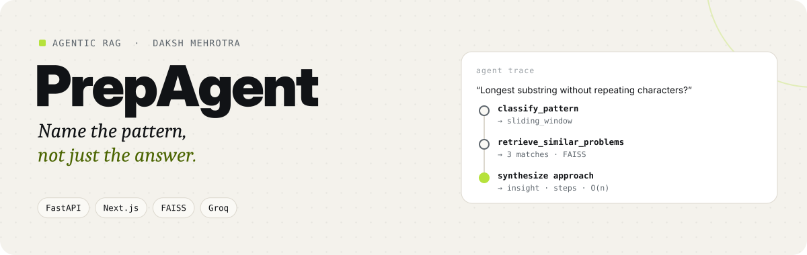

<picture>
  <source media="(prefers-color-scheme: dark)" srcset="assets/banner-dark.svg">
  
</picture>

<br>

**PrepAgent** is an interview-prep copilot for data structures, algorithms and SQL. Paste a problem you're stuck on, and an LLM agent works out which of 10 algorithmic patterns it belongs to, pulls similar problems from a vector index, and walks you through the core insight, an approach and its complexity, without just handing you the code.

## How it works

The agent isn't a fixed pipeline. The model decides for itself which tools to call, in which order, and when it has enough to answer. Every tool call is returned as a **trace**, which the UI shows next to the answer.

| Tool | What it does |
|---|---|
| `classify_pattern` | Labels the problem with one of 10 patterns: two pointers, sliding window, binary search, DFS/backtracking, BFS/graph, dynamic programming, greedy, heap, union-find, prefix sum/hashing |
| `retrieve_similar_problems` | Embeds the question with `all-MiniLM-L6-v2` and searches a FAISS `IndexFlatIP` index (cosine similarity) for the closest problems |

```
question ─► LLM agent ──► classify_pattern ──────────┐
               ▲  │                                  │
               │  └──► retrieve_similar_problems ────┤
               └──────────── tool results ◄──────────┘
                     │
                     ▼
         answer: pattern · core insight · approach · time/space
```

### The classifier

`backend/app/training/train_lora_classifier.py` fine-tunes `distilbert-base-uncased` with LoRA adapters (rank 8 on the attention projections) for 10-way classification, and is set up to run on a Colab T4. Until an adapter is trained and placed in `backend/app/models/lora_classifier/`, the API falls back to a keyword heuristic, so the full pipeline works end to end from day one.

## Stack

| Layer | Tools |
|---|---|
| Agent | Groq `llama-3.3-70b-versatile` (default) or the Anthropic API, with native tool use |
| Retrieval | sentence-transformers, FAISS |
| Classifier | DistilBERT + LoRA (PEFT), with a keyword fallback |
| API | FastAPI: `/api/agent`, `/api/classify`, `/api/retrieve`, `/api/health` |
| Frontend | Next.js 14, Tailwind CSS: chat with an agent-trace panel |
| Deploy | Docker on Render (backend), Vercel (frontend) |

## Run it locally

```bash
# backend
cd backend
python3 -m venv venv && source venv/bin/activate
pip install -r requirements.txt
python -m app.retrieval.build_index        # builds the FAISS index from problems.json
export GROQ_API_KEY=...                    # or LLM_PROVIDER=anthropic + ANTHROPIC_API_KEY
uvicorn app.main:app --reload --port 8000  # docs at http://localhost:8000/docs

# frontend
cd ../frontend
npm install
echo "NEXT_PUBLIC_API_BASE=http://localhost:8000" > .env.local
npm run dev                                # http://localhost:3000
```

Training the classifier and deploying to Render and Vercel are covered step by step in [docs/SETUP.md](docs/SETUP.md).

## Roadmap

- Grow the problem bank from 21 seed problems to 30–50 per pattern and train the LoRA classifier for real
- Cache repeated classify and retrieve calls
- A `/api/feedback` endpoint that logs which suggestions helped, as a signal for later fine-tuning

## Project layout

```
backend/
  app/
    agent/        orchestrator.py (the tool-use loop) · tools.py (schemas + dispatcher)
    retrieval/    build_index.py · retriever.py
    models/       classifier.py (LoRA adapter or keyword fallback)
    training/     train_lora_classifier.py
    routes/       api.py
    data/         problems.json (seed problems, 10 patterns)
  Dockerfile · render.yaml
frontend/         Next.js app: Chat, AgentTrace, PatternBadge
```
